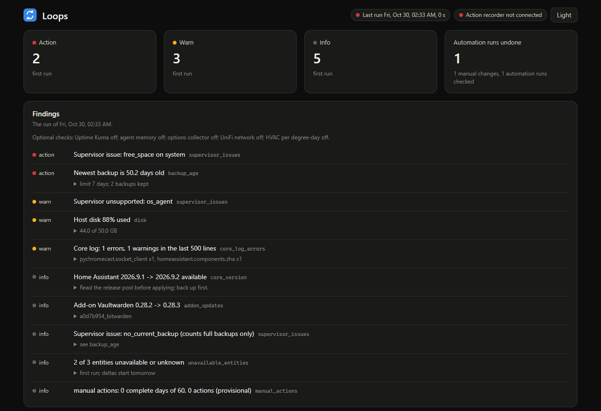

# Loops

A Home Assistant add-on that checks the installation every night and keeps what it finds: updates, Supervisor issues, backup age, disk, entities gone unavailable, Core log errors, safety devices and locks offline, low batteries, automations that reference entities that no longer exist (an automation config that names only devices counts as read). It also keeps the corpus of automations people undo by hand, ranked on its page, and a record of manual actions. Findings are reported when new, on the Loops page in the sidebar and, if you choose, as a phone notification.

## Screenshots



A night's findings by severity, each with the check that raised it, from the test suite's example installation.

## Install

[](https://my.home-assistant.io/redirect/supervisor_add_addon_repository/?repository_url=https%3A%2F%2Fgithub.com%2Fheidrickla%2Fha-loops)
[](https://my.home-assistant.io/redirect/supervisor_addon/?addon=5add8652_loops&repository_url=https%3A%2F%2Fgithub.com%2Fheidrickla%2Fha-loops)

1. Select the first button and add the repository.
2. Select the second button, then Install, then Start. Nothing has to be typed: the checks read the Supervisor and Home Assistant APIs with the add-on's own access.

The add-on runs on amd64 and aarch64.

## Setup

1. Turn on Show in sidebar and open Loops. The first run happens at start; later runs at `run_at`, 03:30 local time by default.
2. Optional: set `notify_target` to a notify service, such as `mobile_app_<device>`, for a nightly summary on your phone.
3. Optional: turn on a check that needs a service of its own by setting its option (below). Each is off and silent until then.

| Check | Turned on by | Found without typing |
|---|---|---|
| Uptime Kuma monitors down | `kuma_api_key` | `kuma_url`, when the Uptime Kuma add-on is installed |
| UniFi network checks | `unifi_username`, `unifi_password` | `unifi_url`: the host's default gateway |
| HVAC energy per cooling degree-day | `hvac_zones`, `outdoor_temperature` | |
| Agent-memory candidate review | `memory_url` | |
| A collector service's weekday run | `collector_url` | |
| Automations failing at run time, entities automations use gone unavailable, custom integrations using a removed API | installing the companion integrations that publish them | their sensors: one never seen is silent, one seen before whose sensors are gone is a failed check |
| Agent Harness Performance Tracker regressions | installing the integration | its regression sensor |

The add-on's documentation tab (`loops/DOCS.md`) describes every check and severity.

## Options

Only `run_at` and `notify_target` show in the form; the rest are under "Show unused optional configuration options".

| Option | Default | Meaning |
|---|---|---|
| `run_at` | `03:30` | local time of the nightly run |
| `notify_target` | empty | notify service for the summary; empty sends nothing |
| `override_window_s` | 300 | a manual change this soon after an automation's counts as an override |
| `backup_max_age_days` | 7 | a newest backup holding Home Assistant older than this is a finding |
| `disk_warn_percent` | 85 | host disk threshold |
| `unavailable_warn_delta` | 25 | this many more unavailable entities than the last run is a warning |
| `log_lines` | 500 | Core log lines scanned |
| `kuma_api_key` | empty | turns the Uptime Kuma check on; down monitors become findings |
| `kuma_url` | empty | Uptime Kuma; empty finds the Uptime Kuma add-on |
| `kuma_ignore` | empty | monitor names left out of the down check, for machines that are off unless needed |
| `unifi_username`, `unifi_password` | empty | a read-only local account on the UniFi OS console, without two-factor sign-in; turns the network checks on |
| `unifi_url` | empty | the console; empty tries the host's default gateway |
| `unifi_fingerprint` | empty | SHA-256 of the console's certificate; set, only that certificate is accepted. A refused certificate's fingerprint is named in the finding |
| `unifi_verify_tls` | true | without a fingerprint, verify the certificate against the system store; off accepts any |
| `isolated_networks` | empty | UniFi networks that should not reach the internal zone |
| `camera_network` | empty | the network every UniFi Protect device should be on |
| `network_dismiss` | empty | keys of network findings not to report, such as `wan_down:WAN2` |
| `hvac_zones` | empty | `name=statistic_id[,statistic_id]` per zone: the energy statistics of the circuits that run it; turns loop 7 on |
| `outdoor_temperature` | empty | statistic id of an outdoor temperature with hourly means |
| `energy_meter` | empty | statistic id of the panel's total energy; an hour it did not move counts every circuit's hour as missing |
| `controller_arm` | `baseline` | label of the thermostat settings in force, recorded per day |
| `controller_from` | empty | first local day measured, `YYYY-MM-DD`; empty is the last 30 days |
| `memory_url` | empty | an agent-memory service whose nightly candidate review is reported |
| `collector_url` | empty | a collector service whose `/runs` the nightly run reads to check its weekday run |
| `api_peers` | empty | other add-ons' host names that may read the API and start a run, such as `a0d7b954-ssh` |

The add-on reads the Supervisor with the `homeassistant` role: its reads are the `info` endpoints and the Core log, and it changes nothing in the Supervisor.

## Endpoints

`/healthz` answers anyone; every other path answers the Supervisor (ingress), Core and `api_peers` only, others get 403.

| Path | Answers |
|---|---|
| `/` | the page, static; it reads the JSON endpoints below by relative path, so it works under ingress |
| `/healthz` | `ok`, for the container's health check |
| `/api/latest.json` | the latest run's findings and `optional`, which of the optional checks are on; the page shows it and the log lists it at start |
| `/api/history.json` | the run history |
| `/api/overrides.json` | the override ranking: per automation, `runs_undone` (one per automation run a person undid, whatever entities it changed), `overrides` (manual changes), `fired` and `rate` (runs undone over fired) over 30 days |
| `/api/snapshot.json` | unavailable or unknown entities and ERROR/WARNING log signatures, read live, with `stop_signatures`: the occurrences logged in the last 15 s before Core exited; 502 when a read fails |
| `/api/controller.json` | the last 60 HVAC days with their inputs' counts, and every week |
| `/api/actions.json` | the collector's connection, today's stream and action rows, its gaps and the latest score |
| `/api/network.json` | the network checks' current items, dismissed keys, WAN readings, latency history and the field names read from the controller |
| `POST /api/run` | runs everything now |

## Layout

| Path | Purpose |
|---|---|
| `loops/config.yaml` | add-on manifest |
| `loops/server.py` | scheduler, store, ingress server, `/api/run` (POST) to run now |
| `loops/checks.py` | the check suite; each check returns findings, a failing check is itself a finding |
| `loops/network.py` | the network checks: UniFi client, rules, new-item reporting |
| `loops/overrides.py` | override detection and the corpus |
| `loops/controller.py` | loop 7: HVAC energy per cooling degree-day |
| `loops/collector.py` | loop 4: the manual-action record and its baseline score |
| `loops/hass_ws.py` | Core's websocket API, standard library |
| `loops/panel.html` | the ingress page: SVG charts drawn in the browser from the `/api` JSON, dark with a light toggle, no external assets |
| `loops/page.py` | loads `panel.html` for the server |
| `tests/` | the suite against a fake Supervisor, the server end to end |

## Develop

The server is the Python standard library on the image's Python 3.12.

```
python -m pytest -q tests
python -m ruff check . && python -m ruff format --check .
```

CI runs these with yamllint, shellcheck, the add-on linter and an image build for each architecture.
